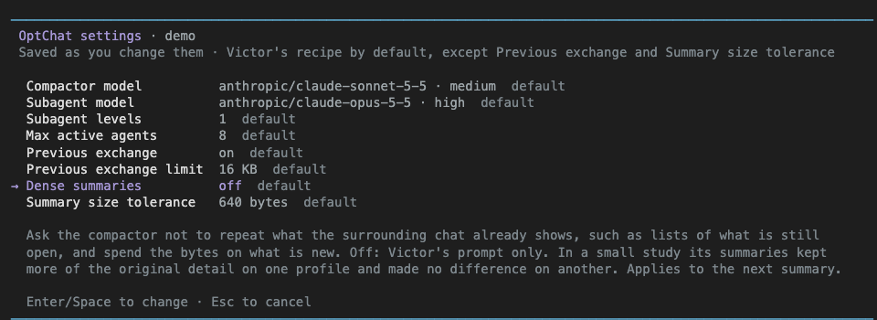
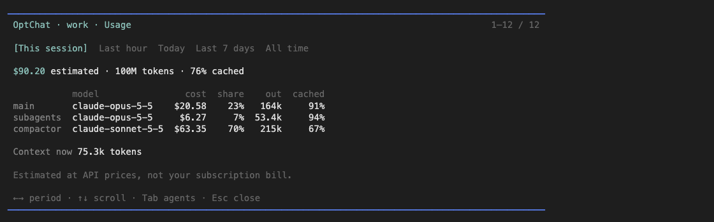
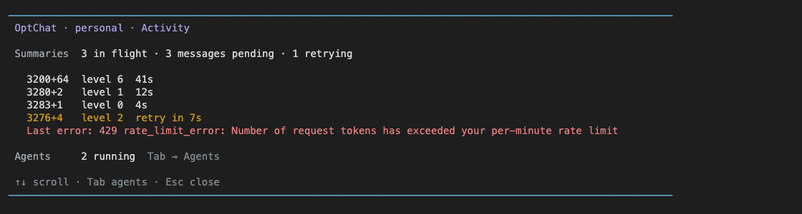

# pi-optchat

A Pi extension that gives you one endless chat per profile, remembered through a summary tree instead of compaction. It implements [Victor Taelin's OptChat recipe](https://gist.github.com/VictorTaelin/91837951a5ce5b38f341ec1ba1df6449).

- **Memory**: every message is kept, and each turn starts from a fresh context holding a bounded view of everything so far.
- **Profiles**: separate memories and instructions, such as `work` and `personal`.
- **Subagents**: delegate tasks to background agents, watch them live, and send them guidance.
- **Import**: bring in history from Claude Code (conversations and memories), Codex, Pi and [OMP](https://github.com/can1357/oh-my-pi), or ChatGPT.
- **Connected windows**: a second Pi window on the same profile becomes a subagent you talk to directly, or opens an existing background subagent.

It runs inside ordinary Pi, with no fork or separate launcher.

## Install

```sh
pi install npm:pi-optchat
pi install npm:pi-web-access   # optional, for web search and page fetching
```

Or from GitHub: `pi install git:github.com/jonaslsaa/pi-optchat`.

Requirements: Pi 1.0.2 or compatible, Node.js 22.19+, and Git. Tested on macOS; the offline tests also run on Linux and Windows.

Web access is not bundled. Subagents load the Pi extensions you have installed (except pi-optchat itself), so installing `pi-web-access` gives web tools to the main agent and every subagent.

To uninstall, run `pi remove git:github.com/jonaslsaa/pi-optchat`. Profile data is kept.

## Quick start

1. Restart Pi.
2. Choose **+ Create profile** and name it, for example `work`.
3. Chat normally.

The footer shows the active profile. Memory follows the profile across directories and Pi sessions. New sessions show the profile picker with the last-used profile first; resumed sessions restore their profile.

### Headless and RPC

- `pi -p`, `--mode rpc` and other extensions' runners need `--optchat-profile work`. Without it (and without a saved profile in a resumed session) the run is plain Pi with no OptChat memory.
- In hosts that create sessions themselves (Pi Web), send `/optchat profile work` as the first message of a new session.
- If the profile is open in another Pi, `pi -p` joins it as a connected window by default; `--optchat-connect auto|join|off` controls this.

Details, errors and join rules: [docs/connected-windows.md](docs/connected-windows.md#headless-and-rpc-runs).

## How it works

- Every message is logged and becomes one line: a short one (up to 512 bytes) word for word, a longer one summarized by the compactor model to about 512 bytes (up to 640 with the default Summary size tolerance).
- Pairs of lines merge into a binary tree of summaries: recent lines cover one message each, older lines cover more.
- Each turn starts from a fresh context: the memory view (the tree's lines, up to 128,000 bytes), your previous exchange, and your new message.
- When the view passes 128,000 bytes, lines merge in one batch down to 64,000, so between merges it only grows at the end and each turn reads the last one's view from the cache.
- The agent reads originals with `zoom` (open a line into the two it was made from, or a message in full) and `date`.

[Victor's recipe](https://gist.github.com/VictorTaelin/91837951a5ce5b38f341ec1ba1df6449) explains the design; [How it differs from the recipe](#how-it-differs-from-the-recipe) lists what OptChat changes.

## Commands

| Command | Action |
| --- | --- |
| `/optchat` | Status and actions menu. |
| `/optchat profile` | Select or create a profile. Switching starts a fresh Pi session. |
| `/optchat settings` | This profile's [settings](#settings). |
| `/optchat model` | Compactor model and effort for this profile. Type to filter the models you are logged in to; the current one is marked. |
| `/optchat agents` | Live agent tree and saved run history. |
| `/optchat agents model` | Subagent model and effort for this profile, picked the same way. |
| `/optchat usage` | Token usage and cost estimates. |
| `/optchat activity` | Memory gauge: view size, summaries catching up, running agents. |
| `/optchat instructions` | Edit this profile's `AGENTS.md`. |
| `/optchat browse` | Open a readable snapshot of memory: the shape of what the model sees, summaries you can open down to the original messages, and search that shows where each message is folded. Run again to refresh. |
| `/optchat import` | Import history, or resume/discard a paused import. |
| `/complete` | In a connected window: end the conversation and hand off to the main agent. With `--optchat-agent`: detach only, leaving the background agent running. |
| `/tell-main <message>` | In a connected window: message the main agent. |

## Models

| Role | Default | Change with |
| --- | --- | --- |
| Main agent | Whatever is selected in Pi | `/model` |
| Subagents | Anthropic Opus 5.5, high | `/optchat agents model` |
| Compactor (summaries, imports, handoffs) | Anthropic Sonnet 5.5, medium | `/optchat model` |

Subagent and compactor settings are saved per profile and do not follow the main model. If you use other providers, change them before chatting. Authentication uses Pi's existing provider login.

Compression and subagents make extra model requests with your provider credentials.

## Settings

`/optchat settings` opens this profile's settings. Each row shows its value and default, the selected row says what it does and when a change applies, and a change is saved right away to the profile's `config.json`. Defaults follow Victor's recipe, except Previous exchange, Summary size tolerance and Turn refresh threshold.

| Setting | Default | What it does |
| --- | --- | --- |
| Compactor model | Sonnet 5.5, medium | Same as `/optchat model`. Applies to the next summary. |
| Subagent model | Opus 5.5, high | Same as `/optchat agents model`. Applies to new subagents. |
| Subagent levels | 1 | 1: only the main agent starts subagents. 2 or more: subagents may start their own, that many levels deep. Applies to subagents started or resumed after the change. |
| Max active agents | 8 | Subagents running at once in the profile, all levels together, so it also caps how deep a chain can go. |
| Group subagent reports | off | Off: each subagent reports as soon as it finishes (the recipe). On: the subagents started by one spawn report together, in one message once the last of them finishes. Applies to the next spawn. |
| Previous exchange | on | Replays your last request and answer in full with the next turn. Off is the recipe. |
| Previous exchange limit | 16 KB | A larger last exchange is left out. |
| Memory search | off | Gives the agent, and subagents started or resumed after the change, a `search` tool over your original messages. Off is the recipe: zoom and date only. Applies from the next turn. |
| Summary size tolerance | 640 bytes | The compactor is always asked for 512-byte lines; a longer line up to this size is kept instead of retried. 512 is the recipe's strict rule. |
| Turn refresh threshold | 30% | Once the current turn's verbatim messages pass this share of the model's context window, they move into memory and the turn goes on with a fresh window (see [Good to know](#good-to-know)). Type 30, 30% or 0.3. 0% is off, as in the recipe. Applies from the next call. |
| Import: summaries at once | 8 | Summaries an import builds at once, 1 to 64. With N at once, a summary can see up to N−1 lines not summarized yet before it, so higher is faster but a little less accurate (at 8 that costs about 0.8 points per summary, #108). Higher also hits your provider's rate limits harder (the compactor retries what is refused). Chat always runs 8. Applies to the next import. |

Numbers must be whole numbers of at least 1 (512 for the summary size tolerance, at most 64 for Import: summaries at once); Turn refresh threshold is a percentage from 0% to 90%. Missing keys in an older `config.json` take their defaults.

**Upgrading from 0.6.x:** subagent levels used to be fixed at 3 and now default to 1, so subagents no longer start their own subagents until you set Subagent levels to 2 or 3.



## Subagents

Ask in plain words, for example: "Spawn an agent to investigate this repository and report back."

- **What they get**: the profile's memory view (frozen at launch) and instructions, read-only `zoom`/`date`, normal coding tools, your installed extensions, and your MCP servers.
- **Reports**: each child reports when it finishes, as one message starting `[id]`, shown in a dark grey `↳ subagent <id>` box. Turn on **Group subagent reports** to get one message per spawn instead.
- **Model**: children run the profile's subagent model. Ask for another in your request ("review it with anthropic/claude-haiku-5-5 at low") and the agent sets that task's `model` and `thinking`.
- **Talking**: the parent sends guidance with `tell`; the child messages its parent mid-run with `tell_parent`. `tell` to a finished child resumes it with its saved transcript.
- **Limits**: by default only the main agent starts subagents. **Subagent levels** lets them delegate further, and **Max active agents** (8) caps how many run at once; going over returns an error, there is no queue.
- **Stopping**: stopping an agent stops its whole subtree. Agents run inside the Pi process, so closing Pi stops them.
- **Restarts**: agents cut off by a close, crash or `/reload` resume when the profile next opens in interactive Pi, and the main agent is told which. Ones you stopped or paused stay stopped.

More (MCP inheritance, per-task models, report formats, the "agents at work" status line, resume rules): [docs/subagents.md](docs/subagents.md).

## Agents, usage and activity inspector

An **Agents | Usage | Activity** bar sits below the input.

| Key | Action |
| --- | --- |
| **Down** (empty input) | Focus the bar |
| **Left/Right**, **Enter** | Pick and open a section |
| **Escape**, **Up**, or typing | Back to the editor |
| **F6** | Open Agents directly, keeping your draft |
| **Tab** | Cycle Agents, Usage and Activity |

Set a different shortcut with `OPTCHAT_INSPECT_KEY=ctrl+shift+a pi`. If another extension supplies a custom editor, OptChat leaves its Down key alone; use the shortcut or commands instead.

**Agents** lists runs as a tree with state, elapsed time, current tool, and last activity. **M** picks the subagent model; **D** twice deletes the selected agent and the agents it started. **Enter** opens that agent's conversation, drawn like the main chat; type to send it guidance.

| Key (in an agent's conversation) | Action |
| --- | --- |
| **Escape** | Clear a draft, else back to the main chat |
| **Ctrl+C** | Clear a draft, else interrupt the agent's current step. Never ends the agent; with nothing queued it waits for you |
| **Up** (empty input) | Take your newest queued message back to edit; send it again, or clear it to drop it |
| **Ctrl+X** twice | Stop this agent and the agents it started (the only key that ends it) |
| **Page Up/Down**, mouse wheel | Scroll; back at the bottom it follows again. The wheel needs Pi's default fullscreen mode |
| **Ctrl+O** | Expand tool output (Pi's own toggle) |

**Usage** shows token use and estimated cost per role and model, for this session, last hour, today, last 7 days, or all time (**Left/Right**). Costs are API prices, not your subscription bill.



**Activity** is a memory gauge: how full the 128 KB view is, whether summaries are **Settled** or **Catching up**, the last error if summarizing keeps failing, and running agents. The bar's Activity item gets a **●** while summaries or agents are at work.



Details (deleting agents, interrupts, usage caveats, failed summaries): [docs/inspector.md](docs/inspector.md).

## Import history

Pick the destination profile, then run `/optchat import`.

1. **Source**: Claude Code, Claude Code memories, Codex, Pi / OMP, or a ChatGPT export (ZIP, folder, or `conversations.json`). Scanning is local and makes no model calls.
2. **Select**: for the local sources, pick projects (busiest first), optionally filter by start date, then take all conversations or pick some.
3. **Mode** (only if the profile already has history): **Append** keeps existing summaries and adds the import (faster, cheaper); **Rebuild by conversation start date** regenerates the whole tree.
4. **Preview**: destination, new and duplicate counts, text size, rough token estimate, and compactor. A big import costs about 3x that estimate in compactor input.

- Only user messages and final assistant replies come in, with original dates and source labels, marked as historical so old requests are not treated as new instructions. Tool calls, reasoning and file bytes are left out.
- Re-importing skips messages already present.
- **Pause import** (or Escape, or restarting Pi) saves progress; `/optchat import` then offers **Resume** or **Discard staged import**. Chat in that profile is blocked while an import is pending.
- Imports switch to the new memory only when the whole tree is ready; the previous one stays on disk. Source files are never modified.

Source paths, selection keys, exactly what is left out, and duplicate rules: [docs/import.md](docs/import.md).

## Connected windows

Each profile is locked to one Pi process. Open the same profile in a second terminal and Pi offers to connect it to the original window as a subagent.

- Your first message starts a subagent in the second window's working directory; later messages continue it. The window looks like a normal Pi chat.
- The subagent runs inside the original process, which stays the only writer of memory.
- `/tell-main <message>` messages the main agent. `/complete` ends the conversation and the compactor writes a handoff for the main agent; closing the window also produces one, marked **interrupted**.
- Text only. The connection is a local socket restricted to your OS user (on Windows a named pipe, without that restriction; see [Windows](#windows)); no daemon or server.

To open an existing background agent instead, pick it from the menu, or pass its ID:

```sh
pi --optchat-profile work --optchat-agent 8ab62e89
```

This opens that same agent's session; what you type is guidance to it. Closing the terminal or `/complete` only detaches, and the agent keeps running.

Details (reload behaviour, handoff limits, attach rules, headless joins): [docs/connected-windows.md](docs/connected-windows.md).

## Storage

Profile data lives in `~/.optchat/profiles/<name>/` (override the root with `OPTCHAT_HOME`):

| Path | Contents |
| --- | --- |
| `main/` | The conversation log (dated JSONL, no reasoning) |
| `tree/` | Summary nodes |
| `active-memory.json`, `memories/<id>/` | After an import: pointer to the active `main/` and `tree/`. Older generations are kept. |
| `imports/pending.json` | Resumable import state |
| `AGENTS.md` | Profile instructions |
| `config.json` | Compactor and subagent models |
| `pending-inputs.json`, `pending-reports.json` | Recovery journals |
| `runs/` | Subagent sessions and run metadata |
| `usage.jsonl` | Usage ledger |
| `memory.html` | Snapshot from `/optchat browse` |

- Each profile folder is a local Git repository, committed after each turn. It has no remote, so it is not a backup: copy the folder while Pi is closed.
- To delete a profile, delete its folder. Your original Pi sessions are kept in Pi's normal session directory.

Git checkpoints and the pluggable `Store` seam (for memory on another machine): [docs/storage.md](docs/storage.md).

## Windows

The same install and commands work on Windows, and the offline tests run there too. What differs:

- The profile lock and connected-window bridge use named pipes instead of socket files, so a Windows profile is not permission-protected the way a POSIX socket file is.
- ZIP exports are read with Windows' own `tar.exe` instead of `unzip`.
- `~` in a subagent task directory is your home directory; `~\project` is read as a home path only on Windows.
- File modes and directory fsync are POSIX-only and are skipped.
- Files are opened with `explorer.exe` instead of `open` or `xdg-open`.

Pipe names and permissions: [docs/storage.md](docs/storage.md#windows-differences).

## Good to know

- **Profiles separate memory and instructions only.** Agents keep full filesystem access and share provider credentials.
- **Use worktrees** when parallel agents edit the same repository; they share the filesystem.
- **Instructions**: the main agent and subagents get Pi's usual global and repository `AGENTS.md` files and your skills, followed by the profile's `AGENTS.md`, which comes last and wins. OptChat replaces only Pi's opening prompt. Prompt templates work in the main session only.
- **Tab title**: `π personal` while waiting for you, `● π personal` while the agent works, plus `· 2 agents` while subagents run. A connected window shows `↳ personal`, `● ↳ personal`, then `↳ personal · done` or `↳ personal · disconnected`. OptChat replaces Pi's default title and puts its own back when Pi resets it (new session, reload, rename).
- **Images** you paste, or a tool returns, are kept under the profile's `images/` (once each, shrunk to 2,048 px on the long side and about 1.5 MB with Pi's own resizer; smaller ones stay as they are). The log names each as `[image <hash>]`, and `zoom(id, 1)` returns a message's images with its text. Summaries stay text. Imported conversations keep a text placeholder.
- **Long turns** (#146): Pi's auto-compaction is off for the main agent, since memory replaces it. Once the current turn's verbatim messages pass the Turn refresh threshold (30% of the model's window by default), they are flushed to memory, the view is rebuilt, and only the task message plus the last tool call and its result stay verbatim; the earlier steps are the view's last lines, a zoom away. In an A/B on a 200K model, turns that otherwise gave up around 100K tokens kept going and covered the whole task. `OPTCHAT_REFRESH_AT` (a fraction, e.g. `0.3`; `0` is off) overrides the setting. Subagents use Pi's own compaction instead, starting at about the same point.
- **Restarts**: unsent inputs are recovered into memory, and pending subagent reports are delivered.
- **Prompt-template inputs** can be saved twice: expanded, and later in their original form as an unanswered input, because Pi expands them after the input journal records them. Skill commands (`/skill:name`) are matched back to their journaled input and don't have this problem. Plain text chat is unaffected.

## How it differs from the recipe

OptChat keeps the recipe's numbers: 512-byte lines, binary merges, the 128,000 → 64,000-byte view, 8 compression workers, 5 shortening attempts, a 30,000-character tool output cap. The ones you can turn off or tune are [settings](#settings). Prompt-by-prompt detail: [docs/recipe-differences.md](docs/recipe-differences.md).

| Area | Recipe | OptChat | Why |
| --- | --- | --- | --- |
| Prompts | The original and 2026-10-08 prompts | The same, lightly adapted, all in `src/prompts.ts`: reports start `[id]`, a note on `[OptChat status]`, "don't poll slow things", the size limit as a ceiling rather than a target | Fit OptChat's tools; the size wording gave less filler with no recall loss (#129) |
| Compactor instructions | Gets your instructions | Doesn't | An A/B found they added nothing (#112) |
| Summary size | Strict 512 bytes | Asked for 512, keeps up to 640 without a retry | Saves retries for a little view space |
| Memory view | Sawtooth, 128,000 → 64,000 bytes | Same, saved to `view.json` and reloaded as it was | |
| Compaction view | Ends at the first unsummarized line | Shows that line as a placeholder and keeps the lines after it | Cutting there hid short lines like an echo's own tool call; summaries scored lower (#101) |
| Tool-result summaries | Result only | Also sees the raw tool call | Recall 3.88 → 4.22 (#153) |
| Cache marks | View in 4-line blocks, one mark on the last whole block | Two more marks, 20 and 40 blocks before it | With one mark, a turn that added over 80 lines made the next turn rewrite the whole view; now up to 240 lines still read from cache |
| Previous exchange | Memory view only | Last request and answer in full (up to 16 KB) | "Why is that?" refers to what you actually read |
| Subagents | Reports start `[Name]` | Built in with Pi's SDK, not a separate package; reports start `[id]`; Subagent levels setting (default 1) | |
| Memory search | Not there | Opt-in `search` over original messages | Exact names, numbers and errors the view doesn't show |
| Large messages | Returned whole, middle cut by the 30,000-character cap | `zoom(id, 1)` pages at 25,000 characters | Nothing cut out |
| Long turns | No limit; a long turn can run out of window | Turn refresh at 30% of the window | Turns kept going past ~100K tokens (#146) |
| Profiles, inspector, usage, import, connected windows | Not there | Added | |
| Computer use, always-on hosting | In the recipe | Not done | |

## Development

```sh
git clone https://github.com/jonaslsaa/pi-optchat.git
cd pi-optchat
npm ci --ignore-scripts
pi install .
```

Restart Pi after source changes. Use `OPTCHAT_HOME` to test against a throwaway data directory.

```sh
npm run check      # type check
npm test           # offline tests, no paid model calls
npm run test:live  # paid Anthropic calls on synthetic data in a disposable profile
```

### Publishing to npm

Pi's [package directory](https://github.com/earendil-works/pi/blob/main/packages/coding-agent/docs/packages.md) lists npm packages with the `pi-package` keyword, which the manifest already has. GitHub alone is not enough.

Publishing a GitHub release publishes to npm. The [Publish workflow](.github/workflows/publish.yml) uses npm trusted publishing, so no token or `npm login` is involved:

1. Merge a PR that bumps `version` in `package.json`.
2. `gh release create vX.Y.Z --target main --generate-notes`

The workflow checks that the tag matches `package.json`, runs the type check and tests, and publishes with provenance. It skips versions already on npm. To retry a tag, run it by hand: `gh workflow run publish.yml -f tag=vX.Y.Z`.

## Credits and license

Based on [Victor Taelin's OptChat recipe](https://gist.github.com/VictorTaelin/91837951a5ce5b38f341ec1ba1df6449) and [OptMem](https://github.com/VictorTaelin/OptMem). His revised gist (2026-10-08) calls his own version UniiChat. This is an independent Pi implementation, not Victor's official OptChat. See [docs/victor-recipe.md](docs/victor-recipe.md) for how the code maps to the recipe.

MIT licensed. See [LICENSE](LICENSE) and [third-party notices](THIRD_PARTY_NOTICES.md).
